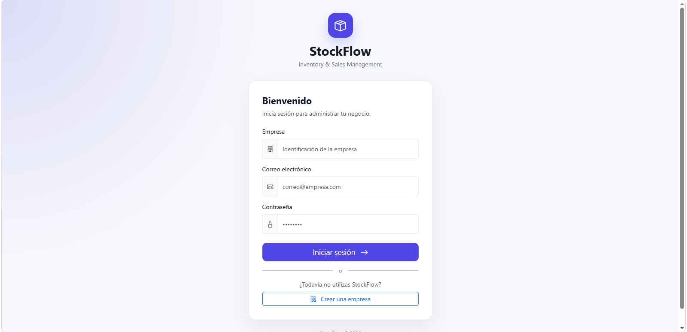
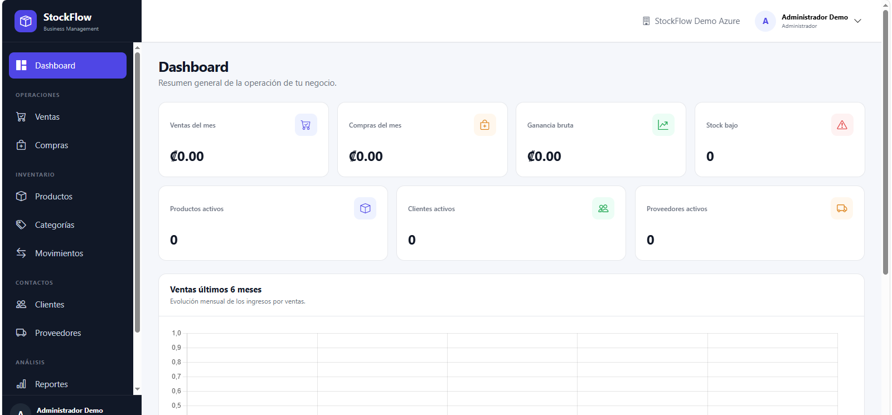
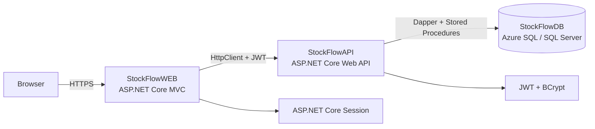

# StockFlow

**Multi-tenant inventory, purchasing, sales, and reporting platform built with ASP.NET Core MVC, ASP.NET Core Web API, Dapper, SQL Server, and Azure.**

[](https://dotnet.microsoft.com/)
[](https://dotnet.microsoft.com/apps/aspnet)
[](https://www.microsoft.com/sql-server)
[](https://azure.microsoft.com/)

## Live Demo

**Web application:** https://stockflow-web-hga-frgsfkb5emedg4e2.centralus-01.azurewebsites.net

The live environment runs on Azure free-tier resources. The first request after a period of inactivity can take longer while the services resume. Once warm, navigation and business operations respond normally.

A new isolated tenant can be created directly from the **Create a company** option on the login screen, so public demo credentials are not required.

## Screenshots

### Login



### Dashboard



## Overview

StockFlow is a production-oriented business management application designed for small and medium-sized companies that need centralized control over inventory, purchases, sales, customers, suppliers, users, and operational reporting.

The solution separates the presentation layer from the backend API. The MVC web application communicates with an ASP.NET Core Web API over HTTPS, while the API is the only component with direct database access. Business writes are executed through SQL Server stored procedures and protected with transactions, validation, role-based authorization, and tenant isolation.

## Main Features

| Area | Capabilities |
|---|---|
| Authentication | Company-based login, BCrypt password hashing, JWT authentication, server-side session in the MVC application |
| Multi-tenancy | Every business record is scoped by `IdEmpresa` obtained from the authenticated JWT, never trusted from client input |
| Roles | Administrator, Employee, and Read-only/Consulta authorization rules |
| Products | Product catalog, automatic per-company product codes, prices, minimum stock, active/inactive state |
| Categories | Category management with role-based write permissions |
| Inventory | Current stock, movement history, manual adjustments, traceability by user and source transaction |
| Purchases | Supplier purchases, server-side totals, automatic stock increase, purchase-cost update, inventory movements |
| Sales | Customer sales, server-side pricing, stock validation and locking, automatic stock decrease, historical cost tracking |
| Customers & Suppliers | Contact management with tenant isolation |
| Dashboard | Monthly sales, purchases, gross profit, low-stock indicators, six-month trend, top-selling products |
| Reports | Sales, purchases, current inventory, low stock, and top-selling products |
| PDF Export | Server-generated PDF reports with QuestPDF |
| User Management | Create, update, activate/deactivate users and assign roles |
| Account | View account information and change own password |
| Error Handling | Production-safe error pages, HTTP status handling, generic client errors and internal server logging |

## Architecture



### Solution Projects

| Project | Responsibility |
|---|---|
| `StockFlowWEB` | MVC UI, Razor Views, session management, API consumption, dashboard UI and PDF generation |
| `StockFlowAPI` | Authentication, authorization, validation, business orchestration, Dapper access and stored-procedure execution |
| `StockFlowDB` | Relational model, constraints, indexes, transactions, stored procedures and reporting queries |

## Technology Stack

| Layer | Technology |
|---|---|
| Runtime | .NET 10 |
| Web | ASP.NET Core MVC, Razor Views |
| API | ASP.NET Core Web API |
| Data access | Dapper |
| Database | SQL Server / Azure SQL Database |
| Authentication | JWT Bearer |
| Password hashing | BCrypt.Net-Next |
| PDF generation | QuestPDF |
| Charts | Chart.js |
| UI | Bootstrap, Bootstrap Icons, custom CSS/JavaScript |
| Cloud | Azure App Service + Azure SQL Database |
| Source control | Git + GitHub |

## Security and Data Isolation

StockFlow follows a server-authoritative security model. The API reads `IdEmpresa`, `IdUsuario`, and role information from validated JWT claims. Tenant identifiers used for database operations are not accepted from the browser as trusted authorization data.

Passwords are stored as BCrypt hashes. Protected API endpoints require JWT authentication, and privileged operations use role-based authorization. The MVC application stores the issued token in server-side session and uses a custom authorization attribute for internal pages.

Database connection strings and JWT secrets are not committed to the repository. Production values are configured through Azure App Service environment variables, while local secrets can be stored with .NET User Secrets.

## Role Model

| Capability | Administrator | Employee | Consulta |
|---|:---:|:---:|:---:|
| View operational data | ✅ | ✅ | ✅ |
| View dashboard and reports | ✅ | ✅ | ✅ |
| Register/edit products, categories, customers and suppliers | ✅ | ✅ | ❌ |
| Register purchases and sales | ✅ | ✅ | ❌ |
| Inventory adjustment | ✅ | ❌ | ❌ |
| Activate/deactivate catalog records | ✅ | ❌ | ❌ |
| User administration | ✅ | ❌ | ❌ |
| Change own password | ✅ | ✅ | ✅ |

## Inventory Integrity

Purchases and sales are processed as transactional operations. Purchase registration increases product stock and creates the corresponding inventory movement. Sales validate available stock before completion, use database locking during the stock check, decrease inventory atomically, and preserve historical cost information.

Inventory adjustments are restricted to administrators and also generate auditable movement records. Quantities are handled consistently by the business rules while monetary calculations remain server-side.

## Database Setup

The `database` directory contains the SQL scripts used to create the Azure SQL deployment. Execute them against an empty `StockFlowDB` database in this order:

```text
01_Estructura.sql
02_Restricciones_Indices.sql
02B_Reparar_Restricciones.sql
StockFlow_Azure_03A_DatosBase_v2.sql
StockFlow_Azure_03B_Procedimientos.sql
```

See [`database/README.md`](database/README.md) for details.

## Local Development

### Requirements

| Requirement | Version / Notes |
|---|---|
| .NET SDK | .NET 10 |
| SQL Server | SQL Server or compatible Azure SQL instance |
| IDE | Visual Studio 2022+ or another .NET-compatible IDE |

### API configuration

`StockFlowAPI` reads the database connection and JWT settings through ASP.NET Core configuration. For local development, use User Secrets or environment variables rather than committing credentials.

```text
ConnectionStringsApi__DefaultConnection
Jwt__SecretKey
Jwt__Issuer
Jwt__Audience
```

### Web configuration

`StockFlowWEB` consumes the API through the named `HttpClient` called `StockFlowAPI`.

```text
ApiSettings__BaseUrl
```

For local development this can point to the local API URL. In Azure it is configured as an App Service environment variable and points to the deployed API.

### Run locally

```bash
dotnet restore
dotnet build
```

Start both projects, with `StockFlowAPI` available before using `StockFlowWEB`.

## Production Deployment

The production environment uses separate Azure App Services for the MVC application and API, plus Azure SQL Database:

```text
Internet
   |
   v
StockFlowWEB (Azure App Service)
   |
   | HTTPS / JWT
   v
StockFlowAPI (Azure App Service)
   |
   | Dapper / Stored Procedures
   v
StockFlowDB (Azure SQL Database)
```

Production secrets and connection strings are configured outside source control through Azure App Service environment variables.

## QA and Validation

The deployed application was validated end-to-end over the public Azure URLs. Validation covered protected endpoints without a token, company registration, Azure SQL writes, BCrypt login verification, JWT creation and validation, authenticated reads and writes, dashboard access, business modules, reports, PDF generation, session behavior, role restrictions, and tenant isolation.

## Project Structure

```text
StockFlow/
├── StockFlowAPI/
│   ├── Controllers/
│   ├── Models/
│   ├── Program.cs
│   └── StockFlowAPI.csproj
├── StockFlowWEB/
│   ├── Attributes/
│   ├── Controllers/
│   ├── Models/
│   ├── Services/
│   ├── Views/
│   ├── wwwroot/
│   ├── Program.cs
│   └── StockFlowWEB.csproj
├── database/
├── docs/
│   └── screenshots/
├── .gitignore
├── README.md
└── StockFlow.slnx
```

## Design Decisions

StockFlow intentionally uses Dapper and stored procedures instead of Entity Framework to keep SQL behavior explicit and to demonstrate transaction handling, output parameters, table-valued parameters, locking, and database-side validation.

The application is multi-tenant by design: a single deployment can serve multiple companies while business data remains isolated by company. Product codes are generated independently per tenant, and authorization is enforced at both application and database-query boundaries.

## Status

**Version 1.0 — deployed and validated.**

The current release is suitable as a portfolio/demo system. Future commercial extensions could include email-based password recovery, electronic invoicing integrations, automated backups/monitoring, CI/CD workflows, and a dedicated production hosting tier.

## Author

Developed by **Henry González Alguera** as a full-stack .NET portfolio project focused on backend architecture, data integrity, security, multi-tenancy, and cloud deployment.

GitHub: https://github.com/HenryGonzalezAlguera
